Hinweis: Die nachfolgende Ausführung ist höchst spekulativ und beinhaltet keine metaphysische Komponente.

1. Der Mensch erkennt durch die Natur seines subjektiven Bewusstseins seit jeher Gegensätzlichkeiten in der Realität (z. B. gut und böse, materiell und geistig, feminin und maskulin).

2. Die persönliche Disposition eines Gegensatzpaares kann auf einer Spannweite (-1 bis 1) als Punkt eingestuft werden:

   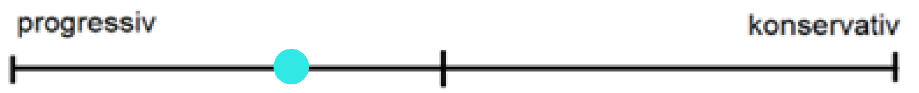

3. Die Tendenz des Kollektivs kann als Bereich eines Spektrums verstanden werden:

   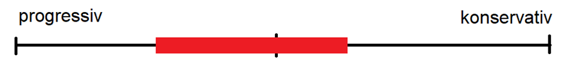

4. Die Verteilung innerhalb des Bereichs wird hier vereinfachend als Normalverteilung modelliert:

   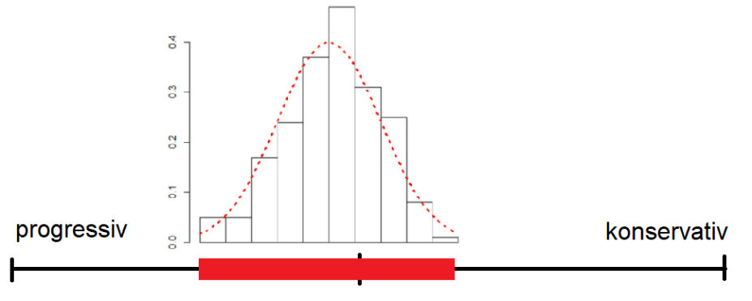

5. Im Verlaufe der Zeit verändert sich die Realität, weshalb sich der Mensch anpassen muss, um zu überleben. Damit verändert sich die Haltung des Kollektivs:

   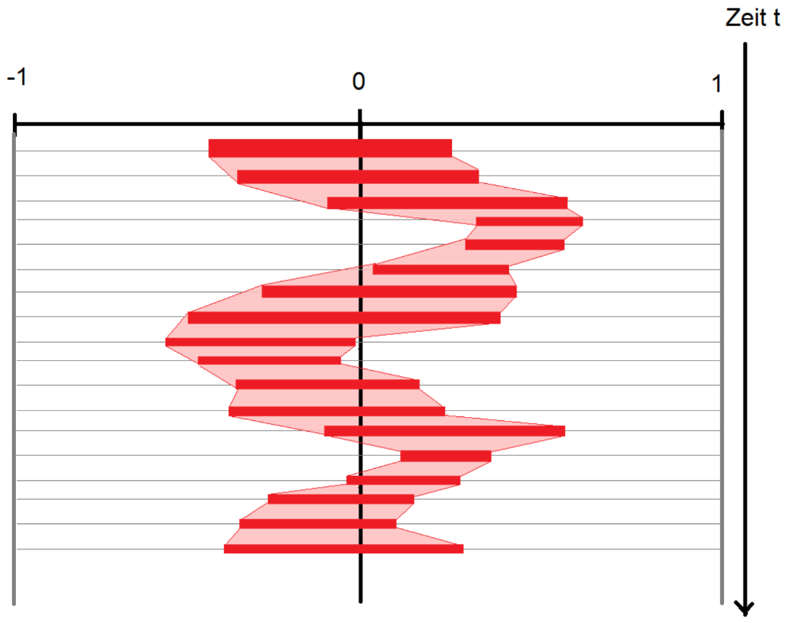

6. Die Richtung der Veränderung hängt davon ab, was die Umwelt zum Überleben des Menschen verlangt. Die optimale und längerfristig notwendige Haltung zum Überleben weicht von der aktuellen Haltung der Menschheit mehr oder weniger stark ab und erzeugt dadurch eine Dissonanz, welche als evolutionärer Bedarf der Menschheit verstanden werden kann.

   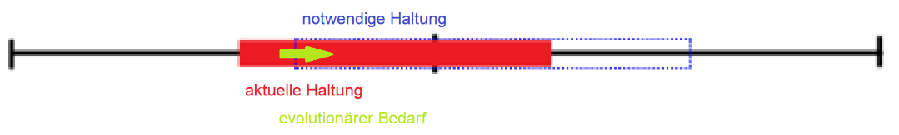

7. Die menschliche Disposition verändert sich stetig, ebenso wie die zum Überleben notwendige Haltung:

   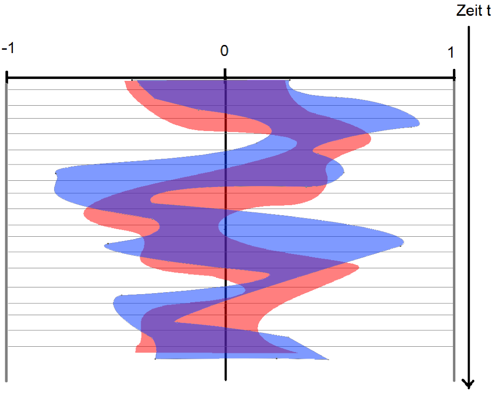

8. Dieser evolutionäre Bedarf wirkt über Generationen, um die kollektive Haltung der effektiv notwendigen Haltung anzunähern:

   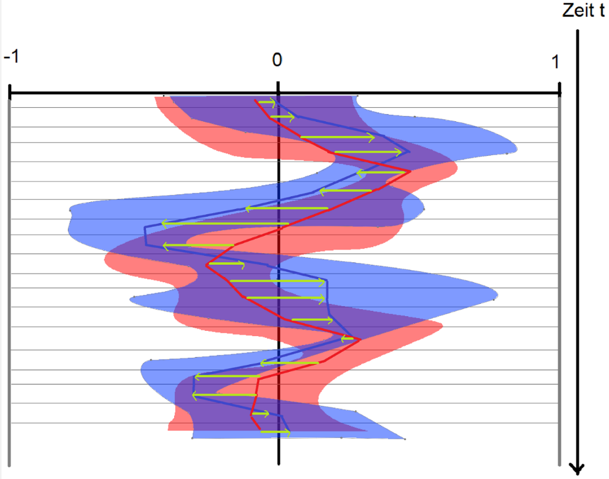

9. Die kollektive Haltung in ihrer Totalität entspricht natürlich nicht nur einem Bereich eines Gegensatzpaares, sondern ist eine mehrdimensionale Auslegung sämtlicher Bestandteile.

10. In der folgenden Darstellung ist ersichtlich, dass unter gewissen Umständen ein Verhalten zum Überleben der Menschheit erforderlich ist, zu dem nur eine Randgruppe fähig ist. Demnach wäre die Spezies unter diesen Bedingungen nur knapp dem Aussterben entgangen:

    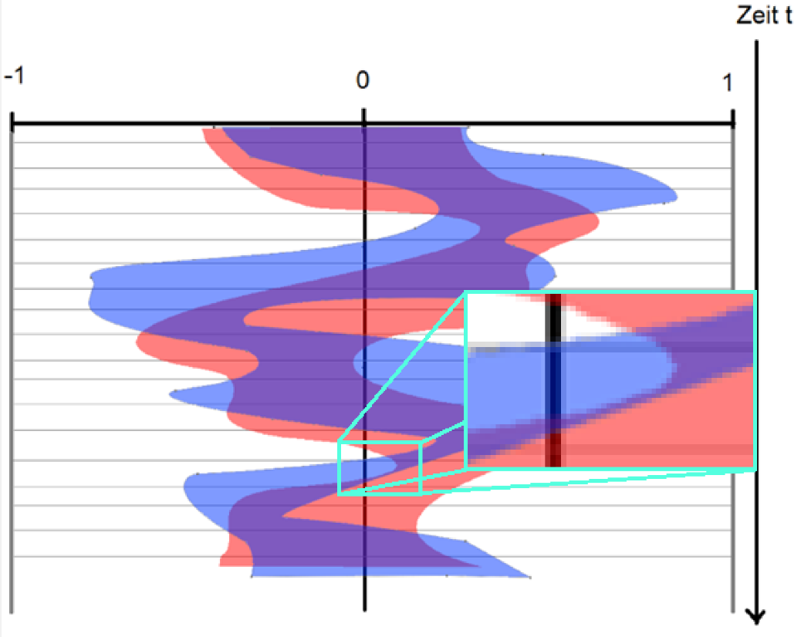

11. Da die Gegensätzlichkeiten von fundamentaler Art sind, wurden sie wesentlich. Das menschliche Wesen wurde mit archetypischen Repräsentationen im Verlaufe der menschlichen Geschichte geprägt. In der Informatik kennt man dies von neuronalen Netzwerken, welche unter anderem visuelle Konzepte festhalten und dadurch verallgemeinerte Repräsentierungen schaffen können, so z. B. «ein männliches Gesicht»:

    Nur handelt es sich beim Menschen nicht bloss um visuelle Konzepte. Archetypen beim Menschen sind stattdessen symbolhafte Abbildungen/Gefühle/Verständnisse, welche die gesamte menschliche Erfahrung sinnhaft erfassen.

    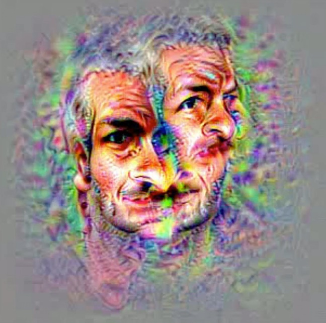

12. Bekannte Archetypen sind (gemäss C. G. Jung) z. B. die «des alten Weisen», «der Anima», «des Animus», «der Ganzheit», «des Geistes», «des Antichristen», «des Gottmenschen», «des Schattens», «des Selbst» und «des Urmenschen». Hierbei handelt es sich nicht um eine abschliessende Liste.

13. Gewisse Archetypen können sich überlappen (z. B. «Selbst» und «Ganzheit» oder «Antichrist» und «Schatten»).

14. Archetypen sind häufig paradoxer Natur (z. B. die «Ganzheit» als Einheit zweier Gegensätze) und können deshalb nicht in ihrer Totalität im Bewusstsein erfasst werden, da das menschliche Bewusstsein nicht mit Paradoxen umzugehen weiss. Sie verweilen stattdessen im Unterbewussten, welches der rationalen Logik entsagt. In Träumen und Visionen können sie jedoch in paradoxer und fantastischer Weise repräsentiert werden.

15. Archetypen sind keine individuelle Errungenschaft, sondern entspringen der Ahnenlinie (dem kollektiven Unbewussten) und werden genetisch vererbt. Als vererbte «Weisheit» fassen sie somit die ganzheitliche Erfahrung der Menschheit. «Als Teil des Ganzen trage ich ein Bild des Ganzen in mir.»

16. Da die Archetypen starken Einfluss auf die Verhaltensweise und das Verständnis der Menschen ausüben, teilen die Individuen gewissermassen dasselbe Schicksal wie ihre Blutlinie. Diese Verhaltenstendenzen dienen dem Überleben, können jedoch auch veraltet sein und müssen deshalb mit dem Verstand überwunden werden.

17. Wie in Punkt 6 aufgezeigt, bedarf die heutige Situation womöglich einer anderen Haltung. Dieses Rebellieren gegen die Tendenzen seiner Vergangenheit ist notwendig, um zu überleben. Als Teil des Ganzen wird mein Verhalten die kollektive Repräsentation minimal verändern und diese dann wieder an die Nachkommenschaft weitergeben.

18. Da unbekannt ist, was die Zukunft von den Menschen fordert, muss ständig abgewogen werden, ob man sich auf die vererbten Instinkte verlassen oder neue Ansätze erproben will.

19. Abhängig vom individuellen Temperament wird das aktuelle Verhalten beibehalten, gestärkt oder geschwächt. Diese «Wette» hinsichtlich der Überlebensfähigkeit wird im nächsten Zyklus zeigen, wer richtig lag. Da sich jedoch auf beiden Seiten Extreme finden, wird in den mehrheitlichen Fällen eine Seite richtig liegen, da der effektive Bedarf (wie die Realität) im stetigen Wandel ist:

    Das heisst, dass die heutigen Extremisten entweder gegen oder für die optimale Haltung des Kollektivs stehen. An ihnen kann die Richtung des potenziellen Entwicklungsbedarfs erkannt werden.

    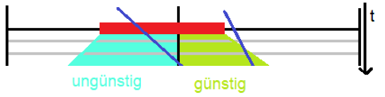

20. Das Verhalten, welches im Durchschnitt überlebensfähig war, definiert die Form des Archetyps:

    Mit seiner paradoxen Natur erfasst er beide Seiten des Spektrums. Mit wiederholt abweichendem Verhalten wird sich die Repräsentation des Archetyps im kollektiven Unbewussten langsam verändern.

    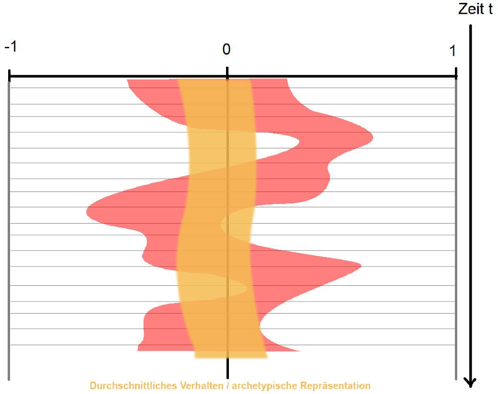

21. Diese Entwicklung charakterisiert nicht nur kollektive Tendenzen, Veranlagungen, Haltungen und Fähigkeiten, sondern kann ebenfalls auf die Entwicklung eines jeden Individuums übertragen werden. Aus der Perspektive des Einzelnen handelt es sich beim zeitlichen Verlauf um Tage, Wochen oder Jahre, während es sich bei der kollektiven Entwicklung um langsamere Veränderungen über Generationen oder Äonen handelt.

22. Die Geschwindigkeit der Veränderung ist am höchsten beim effektiven Entwicklungsbedarf, da dieser in Echtzeit von der Beschaffenheit der Realität abhängig ist. An zweiter Stelle steht die Entwicklung des Individuums, welches sich Tag für Tag an seine Umstände anpasst und relativ flexibel reagieren kann. Am drittschnellsten verändert sich das Kollektiv, welches sich über Jahre und Generationen hinweg entwickelt. Am langsamsten entwickeln sich die Archetypen, welche über Jahrhunderte und ganze Äonen hinweg vom Kollektiv geformt werden.

    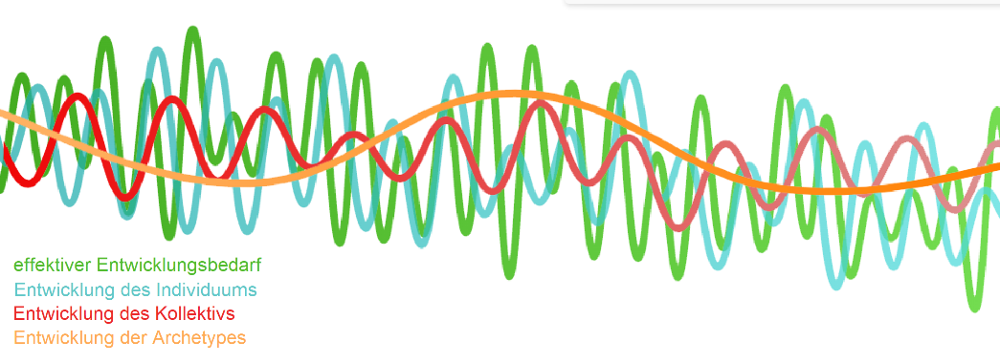

23. Das, was in den Religionen als Gott betitelt wird, umfasst unter anderem ein Gut, welches Orientierung, Halt und Verständnis bietet. Manche stellen sich unter Gott den höchsten Wert einer Wertehierarchie vor. Weitere personifizieren dieses Höchste, um damit ein Ideal und Vorbild zu schaffen, dessen Spirit sie imitieren können. Demnach ist das Gut unter anderem das, was Überleben und Zusammenleben fördert. Gott ist also ein Archetyp, so wie das schon Jung mit seinem «Gottmenschen» erfasst hat – «Gott ist in uns, und jeder von uns ist Teil Gottes». Es ist ein verallgemeinertes Muster, welches jedem von uns eingeprägt ist und das wir über Generationen hinweg weiterformen.

24. Den Überlebensinstinkt als Argument dafür zu verwenden, wie Gott beschaffen ist, scheint mir nicht unvernünftig. Dass die Religionen durch ihre Erfassung von Gott diverse Werte benannt und an die Kultur vermittelt haben, welche grundsätzlich dem Leben dienen sollen, ist eine Notwendigkeit, welche in der menschlichen Geschichte nicht anders hätte kommen können. Böse Werte hätten unausweichlich die Stabilität gefährdet, die Resilienz des Kollektivs geschwächt und die Spezies verelenden lassen. Als Kollektiv, welches seit Hunderttausenden von Jahren lebt, sind wir wesentlich dadurch geprägt, was uns hat überleben lassen. Diese Werte in seinem Selbst zu entdecken, schafft Klarheit darüber, wie der Archetyp von Gott in unserer Kultur geschaffen ist.

25. Da die Archetypen durch die Ahnenlinie geformt werden, ist es auch verständlich, weshalb unterschiedliche Teile des Planeten ‘unterschiedlichen Göttern’ dienen.

26. Dass sich Religionen auf unveränderliche Texte stützen und jenem formulierten Gott dienen, führt dazu, dass sie sich auf ein Abbild eines antiken Archetyps stützen, der heutzutage womöglich nicht mehr in seiner Totalität auf den effektiven Bedarf der Realität passt. Da sich Archetypen sehr langsam entwickeln, ist es andererseits realistisch und nachvollziehbar, dass gewisse Aspekte auch heutzutage noch adäquat und treffend sein können.

27. Zu verstehen, woher man kommt und wer man ist, kann einem zwar dienen, um herauszufinden, wie und wohin man soll, allerdings muss in Betracht gezogen werden, dass komplett neue Muster notwendig sind, wovon unsere Vorfahren nichts hätten wissen können. Demnach sind Sünder notwendig, um das Überleben der Spezies und das Aktualisieren der Archetypen weiterhin zu ermöglichen.

28. Gemäss der Theorie, dass unangepasste Individuen aussterben werden, müssten in den vererbten Archetypen ausschliesslich jene Verhaltensweisen vorhanden sein, welche dem Überleben gedient haben. Allerdings können auch verstorbene Personen ohne Nachwuchs Einfluss auf die vererbten Archetypen gehabt haben, wenn z. B. eine böse Person im Kollektiv gewirkt hat und dadurch den Archetyp des Schattens bei anderen mitgestaltet hat. Ohne Einfluss bleiben aber wohl diejenigen Individuen, die in Einsamkeit gelebt haben.

29. Da archetypische Repräsentationen Muster sind, lassen sich die Archetypen in statische und dynamische unterteilen. Statische Muster sind Konzepte, die sich im Verlaufe der Zeit nicht ändern, z. B. dass es in der Biologie zwei Geschlechter gibt (gemäss den Archetypen «Anima» und «Animus»). Ob diese reine Form erfasst werden kann, ist unwahrscheinlich. Ausserdem gibt es weiterhin dynamische Einflüsse, welche die Erscheinung beeinflussen, so z. B. «der Lifestyle der Männer» auf den Archetyp «Animus», obwohl das Konzept allgemein und statisch bleibt. Dynamische Archetypen sind solche, deren Form sich im Verlaufe der Zeit verändert. Ein Beispiel hierzu ist der Archetyp von Gott, wenn man Gott als das definiert, was dem Leben dient. (Sein Gegenstück wäre der Teufel, welcher dem Tode dient.) Und da ja jenes, was dem Leben dient, stets von der aktuellen Ära abhängt, verändert sich auch das, was Gott ausmacht. Insofern liesse sich Gott auch als Archetyp des evolutionären Bedarfs definieren.

🤔
