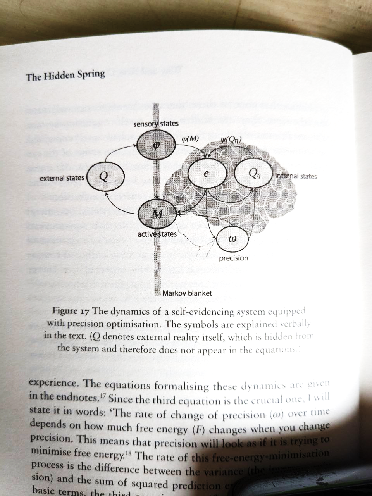
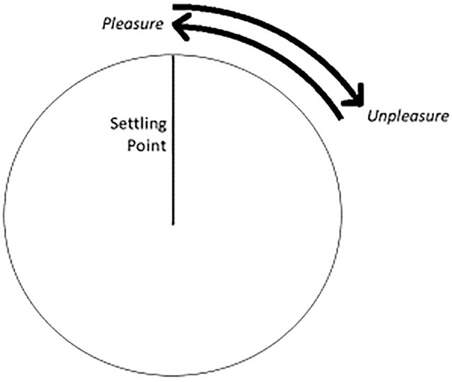

1. Grundlagen:

   > “In the early nineties of the twentieth century Jaak Panksepp coined the term “Affective Neuroscience” (AN) today being accepted as a unique research area in cross-species brain science. By means of (i) electrical stimulation, (ii) pharmacological challenges, and (iii) brain lesions of vertebrate brains (mostly mammalian), Panksepp carved out seven primary emotional systems called SEEKING, CARE, PLAY, and LUST on the positive side, whereas FEAR, SADNESS, and ANGER belong to the negative affects.
   > […] Each of the primal emotional affects is evaluative, that is, has a valence that is either pleasant or aversive and signals objects or situations to approach in the case of the pleasant ones (SEEKING, LUST, CARE, and PLAY) or to avoid in the case of the aversive ones (RAGE, FEAR, and PANIC)” – [Davis und Montag: Selected Principles of Pankseppian Affective Neuroscience](https://www.frontiersin.org/journals/neuroscience/articles/10.3389/fnins.2018.01025/full)

   Das sind die fundamentalsten Affekte, die den Körper antreiben. Da sie eine Valenz (Wertigkeit) haben, ist ihre Intention zielgerichtet und verfolgt einen Zweck: nämlich zu überleben. Damit bilden sie die Grundlage der Wertehierarchie, welche sämtlichen lebenden Systemen zugrunde liegt.

2. Grundlagen:

   > “The free energy principle is a theoretical framework suggesting that the brain reduces surprise or uncertainty by making predictions based on internal models and updating them using sensory input. It highlights the brain's objective of aligning its internal model with the external world to enhance prediction accuracy. This principle integrates Bayesian inference with active inference, where actions are guided by predictions and sensory feedback refines them. It has wide-ranging implications for comprehending brain function, perception, and action.” – [Wikipedia: Free energy principle](https://en.wikipedia.org/wiki/Free_energy_principle)

3. Grundlagen:

   > “A growing literature leverages the Markov blanket construct (Pearl, 1998) to formalise dynamic coupling in physical and biological systems (Friston, 2019a, 2019b, Hipólito, 2019; Ramstead et al., 2018, 2019; Palacios et al., 2020; Kirchhoff et al., 2018). This construct is a description of the dependencies within and between random dynamical systems – like the brain – that sets a boundary between the inside and outside of each system.
   > […] To distinguish a set of systemic (or internal) states from their embedding environment (of external states), a third set of states are implied. These are blanket states (Friston, 2013). The Markov blanket consists of sensory states, which affect but are not affected by internal states; and active states, which affect but are not affected by external states (Fig. 1). This implements conditional independence between internal and external states, under mild assumptions.” – [Hipólito et al.: Markov blankets in the brain](https://pmc.ncbi.nlm.nih.gov/articles/PMC8373616/)

4. Gemäss diesen Ausführungen und den Überlegungen von Prof. Dr. Mark Solms in seinem Buch «The Hidden Spring» sind Menschen selbstorganisierende Systeme (verfügen demnach über einen Markov Blanket), die ihre Bedürfnisse (Affekte) verlässlich stillen können wollen (minimize free energy). Gemäss seiner Abbildung aus dem Buch (S. 208):

   > “Figure 17: The dynamics of a self-evidencing system equipped with precision optimisation.”

   

   Dabei gilt:

   - Q = external reality, which itself is hidden from the system

   - Qn = external states, as modelled by the system’s internal states

   - φ = sensory states

   - M = active states

   - Ψ = predictions

   - ω = precisions

   - e = prediction errors (based on φ and its prediction Ψ)

5. Gemäss Solms (S. 153):

   > “Figure 12: Feeling homeostasis. The settling point represents the system’s viable bounds.”

   Das heisst: Wenn sich Affekte im Körper verändern, bedeutet das, dass sich die jetzige Verfassung zwischen “Pleasure” und “Unpleasure” verschiebt. Ziel der Affekte ist es, den Körper zum “Settling Point” (d. h. in die Homöostase) zurückzubringen und dort zu halten.

   

6. Der Mensch bzw. der menschliche Körper als sich selbst organisierendes System (so gemäss Solms) müsse sich unentwegt die Frage stellen: “What will happen to my free energy if I do that?” Das Ziel sei, Free Energy zu minimieren, um mehr Sicherheit/Gewissheit zu erlangen. Solange das eigene Modell der Realität/Welt keine Überraschung erlebt und die affektiven Bedürfnisse des Körpers gestillt werden, funktioniert die Selbstregulierung automatisch (und demnach unbewusst) gemäss den instinktiven und erlernten Verhaltensweisen. Das ist die energieeffizienteste Variante.

7. Solms (S. 207):

   > “With these relationships in place, it becomes evident that there are in fact three ways for a self-evidencing system to reduce prediction error and thereby minimize free energy […]:
   >
   > 1. It can act (i.e. change M) to alter sensations (φ) so that they match the system’s predictions. This is action.
   >
   > 2. It can change its representation of the world (Qn) to produce a better prediction (Ψ). This is perception. […]
   >
   > 3. It can adjust precision (ω) to optimally match the amplitude of incoming prediction errors (e).”

8. Solms behauptet, dass die Präzisionsanpassung aus Punkt 7.3 (precision adjustment) Bewusstsein sei (S. 207). Die Herleitung und Begründung mit Fakten und experimentellen Beweisen sind nachvollziehbar. Das liegt offenbar mitunter daran, dass die Affekte mit dem Status quo nicht adressiert werden können (d. h. die unbewussten Mechanismen nicht ausreichen [action] oder die Repräsentation der Welt nicht stimmig ist [perception]). Sprich, die energieeffizienteste (unbewusste) Variante der Wiederherstellung der Homöostase funktioniert nicht, weshalb die Affekte die Wahrnehmungsschwelle überschreiten und zu bewussten Gefühlen werden müssen, um deren Relevanz in Anbetracht der Umstände neu zu evaluieren. Fühlen ist demnach der Inbegriff von Bewusstsein, da nichts gefühlt werden kann, was nicht bewusst ist.

9. Das Bewusstsein entstehe im Hirnstamm, da dort sämtliche für diesen Kontext relevanten Funktionen sind (z. B. Quelle der Affekte, Zusammenführen unterschiedlicher Signale sowie zentralisierte unbewusste und bewusste Entscheidungsfindung zum weiteren Vorgehen).

10. Bewusste Kognition (vgl. mit den unbewussten Prozessen) ist für den Körper eine sehr teure Aktion (d. h. verbraucht viel Energie). Eine Konsequenz davon (weiterhin gemäss Solms) ist, dass Bewusstsein in der Kognition per se unerwünscht ist. Was wir demnach anstreben, ist nicht Pleasure (Wohlbefinden), da dies lediglich eine gefühlte (bewusst wahrgenommene) Verbesserung eines affektiven Bedarfs darstellt, sondern vielmehr Zombifizierung (d. h. der Zustand, in dem keine Bedürfnisse unadressiert sind und kein bewusster Aufwand zu deren Stillung notwendig wird). In seinen Worten (S. 222): “No need implies perfect predictions, which means no errors, and therefore no call to increase the precision on incoming signals, and therefore no feeling. Peace at last.” Jedoch sagt er auch (S. 221): “The ideal state is surely one in which all our needs are met automatically – even before they are felt – i.e. where there is no uncertainty. In that theoretical ideal state, in which our needs are met automatically, we feel nothing. […] I say ‘theoretical ideal’ because, in respect of many of our needs, especially the emotional ones, we never get there. The SEEKING drive alone ensures that. This is the bad news.”

Nun zum eher spekulativen und humorvollen Teil – meine Überlegungen:

11. Angenommen, man könnte sämtliche Affekte automatisch stillen, wäre eine unbewusste Existenz möglich. Für die nachfolgenden Ausführungen gehe ich davon aus, dass dies wünschenswert ist.

12. Mir ist aufgefallen, dass z. B. die Zeit vor einem Bildschirm oft unbewusst verstreicht. Meine Vermutung ist, dass dadurch insbesondere der SEEKING-Trieb gestillt wird, da auf Social Media und dergleichen fortlaufend neue Informationen präsentiert werden. Die neuen Informationen sind in diesem Kontext zu erwarten und demnach keine Unsicherheit.

13. Insbesondere VR bietet Möglichkeiten, in eine Welt einzutauchen und sich einem konstanten Strom neuer Informationen auszusetzen.

14. ANGER als Trieb tritt dann auf, wenn etwas zwischen mir und meinem Ziel steht. Wenn mein Ziel die unbewusste Existenz ist, so dürfte dieser Trieb ruhen, solange mich nichts davon abhält (d. h. mir niemand mein VR-Headset entzieht).

15. FEAR tritt nur auf, wenn sich der Körper Sorgen um das Überleben macht. Solange ich gut versorgt im VR-Space verweile, brauche ich keine Angst zu haben. Eventuell ist es empfehlenswert, keine Horror-Spiele zu spielen.

16. SADNESS (auch PANIC oder Separierungsangst genannt) tritt auf, wenn ich etwas verliere. In einer virtuellen Welt stehen die Möglichkeiten offen und ich kann mir alles besorgen, weshalb ich niemals etwas verlieren muss. Eventuell ist es empfehlenswert, das VR-Gerät an eine unendliche Stromversorgung zu binden, damit man nicht von dem Ziel separiert wird.

17. CARE im Sinne der Selbstfürsorge kann gestillt werden, indem die grundlegenden Bedürfnisse (wie z. B. Liegekomfort, Wärme, Hunger und Durst) automatisch adressiert werden. Eventuell ist es empfehlenswert, auf einem Bett o. Ä. zu liegen, das automatisch und regelmässig die Liegeposition des Körpers verändern kann, damit keine Druckstellen entstehen (ähnlich wie bei komatösen Patienten). Weiter empfiehlt sich eine intravenöse Versorgung mit Flüssigkeit und Nährstoffen.

18. PLAY und LUST können normal im VR-Erleben adressiert werden und sollten keine Herausforderung darstellen.

19. Nun muss das VR-Erlebnis nur noch so kalibriert werden, dass konstant interessante Informationen fliessen und keine manuelle Interaktion zur Auswahl der Inhalte notwendig wird. Damit dürften sämtliche Bedürfnisse automatisch adressiert werden und eine unbewusste Existenz realisierbar sein.

Lass mich das versuchen. Sollte nachfolgend nichts mehr folgen, kann man davon ausgehen, dass das Experiment ein Erfolg war. Die Vorkehrungen sind getroffen, u. a. der automatische Versand dieses Dokuments, falls ich im vegetativen Zustand selber nicht mehr das Bewusstsein dazu habe.

Nun denn …

Ich setze das VR-Headset auf:

😄
